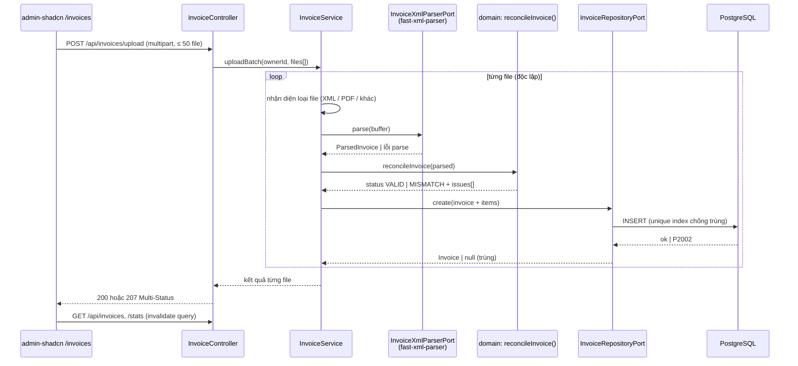

# HoaDon Nhanh — Đặc tả MVP quản lý hóa đơn điện tử cho hộ kinh doanh

| | |
| --- | --- |
| Trạng thái | **Đã phê duyệt có điều kiện** (xem mục 8) — được phép triển khai |
| Phạm vi | `packages/database`, `apps/api`, `packages/api-types`, `apps/admin-shadcn` |
| Tham chiếu | [`rezonia/invoice-processor`](https://github.com/rezonia/invoice-processor) (Go), `docs/architecture.md`, `docs/api-conventions.md`, `.claude/rules/*` |

> Ghi chú ngôn ngữ: tài liệu đặc tả và giao diện người dùng viết bằng tiếng Việt theo yêu cầu sản phẩm. Mã nguồn, comment, commit message vẫn bằng tiếng Anh theo `.claude/CLAUDE.md`.

## 1. Bối cảnh nghiệp vụ

### 1.1. Khung pháp lý

- **Nghị định 123/2020/NĐ-CP** và **Thông tư 78/2021/TT-BTC**: nền tảng hóa đơn điện tử (HĐĐT).
- **Nghị định 70/2025/NĐ-CP** (hiệu lực 01/06/2025) sửa đổi NĐ 123: hộ, cá nhân kinh doanh có doanh thu từ 1 tỷ đồng/năm trở lên và bán hàng/cung cấp dịch vụ trực tiếp cho người tiêu dùng phải dùng HĐĐT khởi tạo từ máy tính tiền có kết nối chuyển dữ liệu với cơ quan thuế.
- **Quyết định 1450/QĐ-TCT** (và bản cập nhật 1510/QĐ-TCT): quy định thành phần chứa dữ liệu nghiệp vụ HĐĐT — tức cấu trúc XML chuẩn mà mọi nhà cung cấp (VNPT, MISA, Viettel, FPT, BKAV…) phải xuất ra.

> Tài liệu này mô tả phần mềm, không phải tư vấn pháp lý. Các ngưỡng doanh thu và thời hạn cần được chủ sản phẩm đối chiếu với văn bản gốc trước khi dùng làm nội dung marketing.

### 1.2. Bài toán thực tế của hộ kinh doanh

Sau NĐ 70/2025, một hộ kinh doanh (tạp hóa, quán ăn, cửa hàng vật liệu…) nhận hàng chục đến hàng trăm HĐĐT đầu vào mỗi tháng từ nhiều nhà cung cấp, mỗi nơi phát hành qua một nền tảng khác nhau. Hộ kinh doanh thường không có kế toán chuyên trách nên gặp các vấn đề:

1. **Hóa đơn nằm rải rác** trong email, Zalo, cổng tra cứu của từng nhà cung cấp; cuối quý không tổng hợp được.
2. **Nhập tay vào Excel** để kê khai, dễ sai số tiền và mã số thuế.
3. **Không phát hiện hóa đơn sai số học** (tiền hàng + thuế ≠ tổng thanh toán), đến khi quyết toán mới lộ.
4. **Nhập trùng hóa đơn** do cùng một file được gửi qua nhiều kênh.

**HoaDon Nhanh** giải quyết bằng một luồng duy nhất: kéo–thả file XML → hệ thống tự đọc, đối soát số học, chống trùng, lưu trữ → xem bảng tổng hợp và xuất Excel.

### 1.3. Phạm vi MVP

| Trong phạm vi | Ngoài phạm vi (lộ trình sau) |
| --- | --- |
| Tải lên theo lô tối đa 50 file | Trích xuất dữ liệu từ PDF/ảnh (OCR, LLM) |
| Parse XML chuẩn 1450/QĐ-TCT + 4 định dạng nhà cung cấp của repo tham chiếu | Xác thực chữ ký số XMLDSig, tra cứu trạng thái trên cổng TCT |
| Đối soát số học, chống trùng | Phát hành hóa đơn đầu ra, kết nối máy tính tiền |
| Danh sách, lọc, chi tiết, thống kê, xuất Excel | Tờ khai thuế, đa chi nhánh, phân quyền kế toán dịch vụ |

File PDF trong MVP **được nhận nhưng không được trích xuất**: API trả kết quả `UNSUPPORTED` cho từng file PDF kèm hướng dẫn tải bản XML (bản XML mới là bản có giá trị pháp lý). Điều này giữ cho vùng tải lên không từ chối im lặng khi người dùng kéo cả thư mục.

## 2. Kiến trúc kỹ thuật

### 2.1. Luồng dữ liệu



Nguyên tắc: **một file lỗi không làm hỏng cả lô**. Mỗi file có kết quả riêng (`CREATED`, `DUPLICATE`, `INVALID`, `UNSUPPORTED`).

### 2.2. Bounded context `invoice` trong `apps/api`

Context có bất biến nghiệp vụ thật (đối soát số học, khóa định danh hóa đơn) nên bắt đầu ở **stage 3** và có `domain/` thuần cho phần tính toán. Không cần aggregate có máy trạng thái vì hóa đơn đã nhập là bất biến.

```
apps/api/src/modules/invoice/
├── domain/
│   ├── invoice.types.ts              # ParsedInvoice, ParsedInvoiceItem, InvoiceProvider, InvoiceStatus
│   ├── decimal.ts (+ .spec.ts)       # số thập phân cố định trên BigInt, không phụ thuộc thư viện
│   └── invoice-reconciliation.ts (+ .spec.ts)   # reconcileInvoice(): thuần
├── application/
│   ├── ports/
│   │   ├── invoice.repository.port.ts
│   │   ├── invoice-xml-parser.port.ts
│   │   └── invoice-excel-exporter.port.ts
│   └── services/invoice.service.ts (+ .spec.ts)
├── infrastructure/
│   ├── adapters/
│   │   ├── xml/                      # registry + 5 adapter, fast-xml-parser
│   │   └── exceljs-invoice-exporter.ts
│   └── repositories/invoice.repository.ts
├── presentation/
│   ├── controllers/invoice.controller.ts
│   └── dtos/
└── invoice.module.ts
```

Tuân thủ `.claude/rules/api.md`:

- `domain/` không import thư viện ngoài (kiểm bởi rule `domain-no-external-libs` của dependency-cruiser). Vì vậy `fast-xml-parser` và `exceljs` nằm ở `infrastructure/adapters/`, sau port.
- Service chỉ inject port bằng `Symbol` token + `import type`; không inject `PrismaService`.
- Controller trả DTO (`InvoiceResponseDto.fromRecord()`), không trả thẳng bản ghi Prisma (stage 3+).
- Không import chéo context. Danh tính người dùng lấy từ `req.user` do `JwtAuthGuard` toàn cục gắn vào.

## 3. Database schema

Thêm vào `packages/database/prisma/schema.prisma`:

```prisma
enum InvoiceStatus {
  VALID      // đối soát khớp
  MISMATCH   // lệch tiền, vẫn lưu để người dùng xử lý

  @@map("invoice_status")
}

enum InvoiceProvider {
  TCT
  VNPT
  MISA
  VIETTEL
  FPT

  @@map("invoice_provider")
}

model Invoice {
  id               String          @id @default(dbgenerated("gen_random_uuid()")) @db.Uuid
  ownerId          String          @map("owner_id")
  provider         InvoiceProvider
  status           InvoiceStatus
  invoiceTemplate  String          @map("invoice_template") @db.VarChar(20)   // KHMSHDon
  invoiceSeries    String          @map("invoice_series") @db.VarChar(20)     // KHHDon
  invoiceNumber    String          @map("invoice_number") @db.VarChar(20)     // SHDon
  issuedAt         DateTime        @map("issued_at") @db.Date                 // NLap
  currency         String          @default("VND") @db.VarChar(3)
  exchangeRate     Decimal         @default(1) @map("exchange_rate") @db.Decimal(18, 6)
  sellerTaxCode    String          @map("seller_tax_code") @db.VarChar(14)
  sellerName       String          @map("seller_name")
  sellerAddress    String?         @map("seller_address")
  buyerTaxCode     String?         @map("buyer_tax_code") @db.VarChar(14)
  buyerName        String?         @map("buyer_name")
  buyerAddress     String?         @map("buyer_address")
  subtotalAmount   Decimal         @map("subtotal_amount") @db.Decimal(18, 2) // TgTCThue
  vatAmount        Decimal         @map("vat_amount") @db.Decimal(18, 2)      // TgTThue
  totalAmount      Decimal         @map("total_amount") @db.Decimal(18, 2)    // TgTTTBSo
  validationIssues Json            @default("[]") @map("validation_issues")
  sourceFileName   String          @map("source_file_name")
  sourceFileHash   String          @map("source_file_hash") @db.Char(64)      // SHA-256
  createdAt        DateTime        @default(now()) @map("created_at") @db.Timestamptz(6)
  updatedAt        DateTime        @default(now()) @updatedAt @map("updated_at") @db.Timestamptz(6)

  owner User          @relation(fields: [ownerId], references: [id], onDelete: Cascade)
  items InvoiceItem[]

  @@unique([sellerTaxCode, invoiceTemplate, invoiceSeries, invoiceNumber], map: "invoices_identity_idx")
  @@index([ownerId, issuedAt], map: "invoices_owner_issued_at_idx")
  @@index([ownerId, status], map: "invoices_owner_status_idx")
  @@map("invoices")
}

model InvoiceItem {
  id              String  @id @default(dbgenerated("gen_random_uuid()")) @db.Uuid
  invoiceId       String  @map("invoice_id") @db.Uuid
  lineNumber      Int     @map("line_number")                               // STT
  code            String? @db.VarChar(50)                                    // MHHDVu
  name            String                                                     // THHDVu
  unit            String? @db.VarChar(50)                                    // DVTinh
  quantity        Decimal @db.Decimal(18, 6)                                 // SLuong
  unitPrice       Decimal @map("unit_price") @db.Decimal(18, 6)              // DGia
  discountAmount  Decimal @default(0) @map("discount_amount") @db.Decimal(18, 2) // STCKhau
  amount          Decimal @db.Decimal(18, 2)                                 // ThTien
  vatRate         String? @map("vat_rate") @db.VarChar(10)                   // TSuat: "10%", "KCT", "KKKNT"…
  vatAmount       Decimal @default(0) @map("vat_amount") @db.Decimal(18, 2)  // TThue

  invoice Invoice @relation(fields: [invoiceId], references: [id], onDelete: Cascade)

  @@index([invoiceId], map: "invoice_items_invoice_id_idx")
  @@map("invoice_items")
}
```

Quyết định thiết kế:

- **Chống trùng** bằng unique index ghép `[sellerTaxCode, invoiceTemplate, invoiceSeries, invoiceNumber]` — đúng bộ khóa định danh một hóa đơn theo NĐ 123. Trùng lặp được phát hiện ở tầng DB (bắt lỗi Prisma `P2002`), không phải `SELECT` rồi `INSERT`, nên an toàn khi tải lên đồng thời.
- **Tiền dùng `Decimal(18,2)`**, số lượng/đơn giá `Decimal(18,6)`. Không dùng `Float`.
- **`vatRate` là chuỗi**: chuẩn 1450 cho phép giá trị không phải số (`KCT` — không chịu thuế, `KKKNT` — không kê khai nộp thuế, `KHAC:x%`).
- **Không lưu XML gốc** trong MVP (giảm bề mặt dữ liệu nhạy cảm); chỉ lưu tên file và SHA-256 để truy vết.
- `validationIssues` lưu danh sách `{ code, message }` do bước đối soát sinh ra, để dialog chi tiết giải thích vì sao hóa đơn bị đánh dấu lệch tiền.
- Migration tạo bằng `db:migrate` và commit SQL; export alias `InvoiceDatabase`, `InvoiceItemDatabase`, `InsertInvoiceDatabase` từ `src/types.ts`.

## 4. Đặc tả parser XML (chuyển thể Go → TypeScript)

### 4.1. Những gì giữ lại từ repo tham chiếu

Repo Go dùng **mẫu Adapter + Registry** (`internal/parser/xml/adapter.go`): mỗi nhà cung cấp một adapter có `CanParse(content)` và `Parse(content)`, registry duyệt theo thứ tự từ đặc thù đến tổng quát. Bản TypeScript giữ nguyên mô hình này:

```ts
interface InvoiceXmlAdapter {
  readonly provider: InvoiceProvider
  canParse(root: XmlNode): boolean
  parse(root: XmlNode): ParsedInvoice
}
```

Các hành vi được chuyển thể:

| Hành vi trong Go | Bản TypeScript |
| --- | --- |
| `encoding/xml` unmarshal vào struct | `fast-xml-parser` → cây object, đọc bằng helper `text(node, 'Tag')` |
| `shopspring/decimal` | giữ nguyên chuỗi thập phân từ XML → `domain/decimal.ts` (BigInt, 6 chữ số thập phân) |
| `parseDate` thử 5 định dạng | `parseInvoiceDate`: `YYYY-MM-DD`, `DD/MM/YYYY`, có/không kèm giờ, RFC 3339 |
| Viettel adapter hỗ trợ cả `HDon/DLHDon/NDHDon` (TCT 2.0) và dạng phẳng | gộp vào adapter chuẩn TCT (mục 4.2) |
| Trả hóa đơn đầu tiên khi file chứa nhiều hóa đơn | giữ nguyên; ghi rõ là giới hạn MVP |

### 4.2. Những điểm sửa so với repo tham chiếu

Khi đối chiếu mã Go với chuẩn 1450/QĐ-TCT phát hiện các sai lệch, bản TypeScript **không** sao chép:

1. **Nhận diện bằng `bytes.Contains`** trên toàn bộ nội dung (`"fpt"`, `"misa"`, `"vnpt"`…): một hóa đơn chuẩn TCT có người bán tên "Công ty FPT" sẽ bị nhận nhầm. → Nhận diện theo **phần tử gốc và cấu trúc** sau khi parse.
2. **`KHMSHDon` bị gán vào `Series`**: theo chuẩn, `KHMSHDon` là *ký hiệu mẫu số* (template), `KHHDon` mới là *ký hiệu hóa đơn* (series). → Ánh xạ đúng cả hai; đây là điều kiện để unique index 4 trường có nghĩa.
3. **Cấu trúc `HDon/DLHDon` được gán cho Viettel**: đây chính là cấu trúc chuẩn TCT mà mọi nhà cung cấp dùng. → Adapter chuẩn 1450 mang nhãn nhà cung cấp theo thông tin trong `TTKhac`/`TTin` nếu xác định được, mặc định `TCT`.
4. **Nuốt lỗi parse số** (lỗi → 0): một tổng tiền hỏng sẽ thành 0 và lọt qua. → Trường tiền bắt buộc không parse được là lỗi `INVALID`.
5. **`TSuat` ép về số nguyên**: `"10%"` parse lỗi thành 0; `KCT` mất nghĩa. → Giữ chuỗi gốc, chuẩn hóa phần trăm khi tính.
6. **Đối soát chỉ là cảnh báo và bị bỏ qua khi thuế = 0**. → Luôn đối soát (mục 4.5).

### 4.3. Thẻ XML chuẩn 1450/QĐ-TCT

```
HDon
└── DLHDon
    ├── TTChung                     Thông tin chung
    │   ├── PBan                    Phiên bản XML
    │   ├── THDon                   Tên hóa đơn
    │   ├── KHMSHDon                Ký hiệu mẫu số            → invoiceTemplate
    │   ├── KHHDon                  Ký hiệu hóa đơn           → invoiceSeries
    │   ├── SHDon                   Số hóa đơn                → invoiceNumber
    │   ├── NLap                    Ngày lập (YYYY-MM-DD)     → issuedAt
    │   ├── DVTTe                   Đơn vị tiền tệ            → currency (mặc định VND)
    │   ├── TGia                    Tỷ giá                    → exchangeRate (mặc định 1)
    │   └── HTTToan                 Hình thức thanh toán
    └── NDHDon                      Nội dung hóa đơn
        ├── NBan  { Ten, MST, DChi, SDThoai, DCTDTu }         → seller*
        ├── NMua  { Ten, MST, DChi, HVTNMHang }               → buyer*
        ├── DSHHDVu
        │   └── HHDVu[]             Hàng hóa, dịch vụ
        │       ├── TChat           Tính chất (1 hàng hóa, 2 khuyến mại, 3 chiết khấu, 4 ghi chú)
        │       ├── STT             → lineNumber
        │       ├── MHHDVu          → code
        │       ├── THHDVu          → name
        │       ├── DVTinh          → unit
        │       ├── SLuong          → quantity
        │       ├── DGia            → unitPrice
        │       ├── TLCKhau, STCKhau → discountAmount
        │       ├── ThTien          → amount (chưa thuế)
        │       ├── TSuat           → vatRate
        │       └── TThue           → vatAmount (không bắt buộc ở cấp dòng)
        └── TToan                   Thanh toán
            ├── THTTLTSuat/LTSuat[] { TSuat, ThTien, TThue }  Tổng hợp theo thuế suất
            ├── TgTCThue            Tổng tiền chưa thuế       → subtotalAmount
            ├── TgTThue             Tổng tiền thuế            → vatAmount
            ├── TTCKTMai            Tổng chiết khấu thương mại
            ├── TgTTTBSo            Tổng thanh toán bằng số   → totalAmount
            └── TgTTTBChu           Tổng thanh toán bằng chữ
```

Quy tắc đọc:

- Chấp nhận cả dạng lồng `HDon/DLHDon/NDHDon` và dạng phẳng `HDon/{TTChung,NBan,NMua,DSHHDVu,TToan}` (repo tham chiếu có fixture dạng phẳng).
- `HHDVu` luôn được coi là mảng (cấu hình `isArray` của fast-xml-parser) kể cả khi chỉ có một dòng.
- Hóa đơn bán hàng (mẫu số 2, hộ kinh doanh phát hành) **không có** `TgTCThue`/`TgTThue`: khi vắng, `subtotalAmount = totalAmount`, `vatAmount = 0`.
- `STT` vắng → dùng thứ tự xuất hiện.
- Mọi giá trị được `trim()`; giá trị số giữ ở dạng chuỗi (`parseTagValue: false`) để không mất số 0 đầu của `SHDon`/`MST` và không mất độ chính xác.

### 4.4. Các định dạng nhà cung cấp (theo fixture của repo tham chiếu)

| Trường chuẩn | VNPT `<SInvoice>` | MISA `<Invoice><InvoiceData>` | FPT `<EInvoice>` | TCT generic `<Invoice>` / `<Invoices>` |
| --- | --- | --- | --- | --- |
| Số HĐ | `InvoiceNo` | `InvoiceData/InvoiceNumber` | `Header/InvoiceNumber` | `InvoiceNo` |
| Ký hiệu | `InvoiceSeries` | `InvoiceData/InvoiceSeries` | `Header/InvoiceSeries` | `InvoiceSeries` |
| Ngày lập | `InvoiceDate` | `InvoiceData/InvoiceDate` | `Header/InvoiceDate` | `InvoiceDate` |
| MST người bán | `Seller/SellerTaxCode` | `SellerInfo/MST` | `Seller/TaxCode` | `Seller/TaxID` |
| Tên người bán | `Seller/SellerName` | `SellerInfo/CompanyName` | `Seller/CompanyName` | `Seller/Name` |
| MST người mua | `Buyer/BuyerTaxCode` | `BuyerInfo/MST` | `Buyer/TaxCode` | `Buyer/TaxID` |
| Dòng hàng | `Products/Product[]` | `InvoiceDetail/Item[]` | `Details/Line[]` | `Items/Item[]` |
| Tên hàng | `ProdName` | `TenHang` | `ProductName` | `ItemName` |
| SL / đơn giá | `ProdQuantity` / `ProdPrice` | `SoLuong` / `DonGia` | `Quantity` / `UnitPrice` | `Quantity` / `UnitPrice` |
| Thành tiền | `Amount` | `ThanhTien` | `LineAmount` | `Amount` |
| Thuế suất / tiền thuế | `VATRate` / `VATAmount` | `ThueSuat` / `TienThue` | `VATRatePercent` / `VATAmount` | `TaxRatePercent` / `TaxAmount` |
| Tiền chưa thuế | `Summary/TotalAmount` | `TotalSection/TongTienHang` | `Totals/SubTotal` | `SubtotalAmount` |
| Tiền thuế | `Summary/TotalVATAmount` | `TotalSection/TongTienThue` | `Totals/TotalVAT` | `TaxAmount` |
| Tổng thanh toán | `Summary/TotalPayment` | `TotalSection/TongThanhToan` | `Totals/GrandTotal` | `TotalAmount` |

Các định dạng này không có ký hiệu mẫu số riêng → `invoiceTemplate = ''` (chuỗi rỗng, không phải `NULL`, để unique index vẫn có hiệu lực).

Thứ tự nhận diện: `HDon` (chuẩn 1450) → `SInvoice` (VNPT) → `EInvoice` (FPT) → `Invoice` có `InvoiceData` (MISA) → `Invoice`/`Invoices` (TCT generic). Không khớp → lỗi `INVOICE_UNKNOWN_FORMAT`.

### 4.5. Công thức đối soát số học

`reconcileInvoice(parsed)` là hàm thuần trong `domain/`, tính trên số thập phân cố định (BigInt), không dùng `number`.

| Mã | Quy tắc | Mức |
| --- | --- | --- |
| `TOTAL_MISMATCH` | `subtotalAmount + vatAmount == totalAmount` | Lỗi → `MISMATCH` |
| `SUBTOTAL_MISMATCH` | `Σ item.amount == subtotalAmount` (bỏ dòng ghi chú `TChat = 4`; dòng chiết khấu `TChat = 3` mang dấu âm) | Lỗi → `MISMATCH` |
| `VAT_MISMATCH` | `Σ item.vatAmount == vatAmount`, chỉ kiểm khi mọi dòng chịu thuế đều có `TThue` | Lỗi → `MISMATCH` |
| `LINE_AMOUNT_MISMATCH` | `quantity × unitPrice − discountAmount == amount` | Cảnh báo, không đổi trạng thái |

Dung sai: **±1 đơn vị tiền tệ cho mỗi dòng hàng tham gia phép cộng** (tối thiểu 1) đối với các quy tắc tổng, vì nhà cung cấp làm tròn thuế theo từng dòng. `TOTAL_MISMATCH` dùng dung sai cố định 1. Hóa đơn `MISMATCH` **vẫn được lưu** và hiển thị cảnh báo: người dùng cần thấy nó để yêu cầu người bán lập hóa đơn điều chỉnh, không phải để hệ thống giấu đi.

### 4.6. Xử lý file đầu vào an toàn

- **Nhận diện theo nội dung, không tin `mimetype`/đuôi file** do client gửi: bỏ BOM và khoảng trắng đầu, bắt đầu bằng `<` → XML; bắt đầu bằng `%PDF-` → PDF; còn lại → `INVOICE_UNSUPPORTED_FILE`.
- **Chống XXE / entity expansion**: cấu hình `processEntities: false`; từ chối mọi file có `<!DOCTYPE` hoặc `<!ENTITY` (`INVOICE_XML_MALFORMED`). HĐĐT hợp lệ không dùng DTD.
- Chạy `XMLValidator.validate()` trước khi parse để phát hiện XML cắt cụt (fast-xml-parser mặc định khoan dung với XML hỏng).
- Giải mã UTF-8; bỏ tiền tố namespace (`removeNSPrefix: true`) để `<inv:HDon>` vẫn được nhận diện; bỏ qua attribute.
- Chuỗi lấy từ XML bị cắt theo độ dài cột trước khi lưu; số dòng hàng tối đa 1.000/hóa đơn.
- Adapter không ném lỗi thô: mọi lỗi được chuyển thành `InvoiceParseError { code, message }` để service ghi vào kết quả từng file.

### 4.7. Điều kiện bắt buộc (lỗi `INVALID`, không lưu)

- Thiếu số hóa đơn, ngày lập, MST người bán, hoặc tổng thanh toán.
- MST người bán không đúng dạng `^\d{10}(-?\d{3})?$` (10 số hoặc 13 số của đơn vị phụ thuộc; chuẩn hóa bỏ dấu gạch khi lưu).
- Ngày lập không parse được hoặc ở tương lai quá 1 ngày.
- Trường tiền bắt buộc không phải số.

## 5. API Specifications

Tất cả endpoint nằm dưới `/api/invoices`, yêu cầu JWT (guard toàn cục), mọi lỗi theo **RFC 9457** qua `ProblemDetailsFilter`. Dữ liệu luôn được lọc theo `ownerId = req.user.id`.

| Method | Path | Mô tả | Thành công |
| --- | --- | --- | --- |
| `POST` | `/api/invoices/upload` | Tải lên lô ≤ 50 file (`multipart/form-data`, field `files`) | `200` mọi file được tạo; `207` nếu có file không được tạo |
| `GET` | `/api/invoices` | Danh sách phân trang offset + bộ lọc | `200` `{ object: 'list', data, page, pageSize, total, hasMore }` |
| `GET` | `/api/invoices/stats` | Số liệu cho summary cards (cùng bộ lọc) | `200` |
| `GET` | `/api/invoices/export` | Xuất Excel (cùng bộ lọc) | `200` `application/vnd.openxmlformats-officedocument.spreadsheetml.sheet` |
| `GET` | `/api/invoices/:id` | Chi tiết kèm dòng hàng | `200` |
| `DELETE` | `/api/invoices/:id` | Xóa hóa đơn nhập nhầm | `204` |

### 5.1. `POST /api/invoices/upload`

Giới hạn: 50 file/lô, 2 MB/file, lưu bộ nhớ (`memoryStorage`, tối đa 100 MB/request), không ghi đĩa. Dùng cấu hình Multer riêng của context `invoice`, **không** sửa hay import `modules/upload` (giới hạn 5 file, chỉ ảnh/PDF, ghi đĩa — khác mục đích và import chéo context bị cấm). Endpoint có `@Throttle` riêng (10 request/phút). File được xử lý **tuần tự** trong một request để hai bản sao trong cùng lô cho kết quả xác định (`CREATED` rồi `DUPLICATE`).

```json
{
  "total": 3, "created": 1, "duplicated": 1, "failed": 1,
  "results": [
    { "fileName": "hd-001.xml", "outcome": "CREATED", "invoiceId": "…", "status": "VALID", "invoiceNumber": "00000123" },
    { "fileName": "hd-001-copy.xml", "outcome": "DUPLICATE", "code": "INVOICE_DUPLICATE", "message": "Hóa đơn đã tồn tại trong hệ thống" },
    { "fileName": "scan.pdf", "outcome": "UNSUPPORTED", "code": "INVOICE_PDF_NOT_SUPPORTED", "message": "Chưa hỗ trợ đọc PDF, vui lòng tải file XML" }
  ]
}
```

`outcome`: `CREATED` | `DUPLICATE` | `INVALID` | `UNSUPPORTED`. Lỗi cấp request (không có file, vượt 50 file, file vượt kích thước) trả problem details `422`/`413` với `code` tương ứng.

### 5.2. Bộ lọc dùng chung cho list / stats / export

| Tham số | Kiểu | Ý nghĩa |
| --- | --- | --- |
| `page`, `pageSize` | số | kế thừa `OffsetPaginationDto` (chỉ list) |
| `q` | chuỗi ≤ 100 | tìm theo số hóa đơn, tên hoặc MST người bán |
| `status` | `VALID` \| `MISMATCH` | trạng thái đối soát |
| `provider` | enum | nhà cung cấp |
| `issuedFrom`, `issuedTo` | `YYYY-MM-DD` | khoảng ngày lập (bao gồm hai đầu) |

### 5.3. `GET /api/invoices/stats`

```json
{ "totalInvoices": 42, "validCount": 40, "mismatchCount": 2,
  "subtotalAmount": "125000000.00", "vatAmount": "10500000.00", "totalAmount": "135500000.00" }
```

`/export` giới hạn 5.000 hóa đơn mỗi lần; vượt quá trả `422 INVOICE_EXPORT_TOO_LARGE` và yêu cầu thu hẹp bộ lọc. Các route tĩnh `stats`, `export`, `upload` khai báo **trước** `:id`; `:id` dùng `ParseUUIDPipe`.

Số tiền trả về dạng **chuỗi thập phân** trên mọi endpoint để tránh sai số `number` của JavaScript.

### 5.4. Mã lỗi mới (`error-code.ts`)

`INVOICE_NOT_FOUND` (404), `INVOICE_DUPLICATE`, `INVOICE_XML_MALFORMED`, `INVOICE_UNKNOWN_FORMAT`, `INVOICE_MISSING_FIELD`, `INVOICE_INVALID_FIELD`, `INVOICE_PDF_NOT_SUPPORTED`, `INVOICE_UNSUPPORTED_FILE`, `INVOICE_BATCH_EMPTY` (422), `INVOICE_BATCH_TOO_LARGE` (422), `INVOICE_EXPORT_TOO_LARGE` (422).

## 6. UI/UX Specs (`apps/admin-shadcn`)

- Route `app/(protected)/invoices/page.tsx` mỏng, render `features/invoices/invoices-page.tsx`. Đường dẫn khai báo trong `config/app-paths.ts`; thêm mục **"Hóa đơn"** vào sidebar (mọi người dùng đã đăng nhập, không giới hạn `ADMIN`).
- Toàn bộ nhãn tiếng Việt. Tiền: `Intl.NumberFormat('vi-VN', { style: 'currency', currency })` → `1.250.000 ₫`. Ngày: `dd/mm/yyyy`.

| Thành phần | Hành vi |
| --- | --- |
| **Summary cards** (4 thẻ) | Tổng số hóa đơn · Tổng tiền trước thuế · Tổng tiền thuế GTGT · Tổng thanh toán (kèm số hóa đơn lệch tiền). Theo bộ lọc hiện tại. |
| **Vùng tải lên** | Kéo–thả hoặc bấm chọn nhiều file `.xml`/`.pdf`; chặn phía client khi > 50 file hoặc file > 2 MB; hiển thị tiến trình và bảng kết quả từng file (Đã lưu / Trùng lặp / Lỗi / Chưa hỗ trợ) sau khi tải. |
| **Bộ lọc** | Ô tìm kiếm (debounce), chọn trạng thái, nhà cung cấp, từ ngày – đến ngày, nút "Xóa bộ lọc". |
| **Bảng (TanStack Table)** | Cột: Số HĐ · Ký hiệu · Ngày lập · Người bán (tên + MST) · Tiền hàng · Thuế GTGT · Tổng thanh toán · Trạng thái · thao tác. Phân trang phía server. Dùng `components/data-table`. |
| **Status badge** | `VALID` → "Hợp lệ" (xanh); `MISMATCH` → "Lệch tiền" (đỏ). |
| **Dialog chi tiết** | Bấm vào dòng: thông tin chung, người bán/người mua, bảng dòng hàng, khối tổng tiền, danh sách cảnh báo đối soát nếu có. |
| **Xuất Excel** | Nút "Xuất Excel" gọi `/export` với bộ lọc hiện tại, tải `hoa-don-YYYYMMDD.xlsx`. Sheet "Hóa đơn" (mỗi hóa đơn một dòng) và sheet "Chi tiết" (mỗi dòng hàng một dòng). |
| Trạng thái rỗng / lỗi | "Chưa có hóa đơn nào. Kéo thả file XML để bắt đầu."; lỗi API hiện toast (`sonner`) với `detail` của problem details. |

Kiểu dữ liệu lấy từ `@workspace/api-types` (sinh lại sau khi API chạy), gọi qua `openapi-react-query` như các feature hiện có.

## 7. Test Plan

### 7.1. Fixture (`apps/api/test/fixtures/invoices/`)

| File | Mục đích |
| --- | --- |
| `tct-valid.xml` | Chuẩn 1450 dạng lồng, 2 dòng hàng, thuế 8% và 10%, khớp |
| `tct-sales-invoice.xml` | Hóa đơn bán hàng của hộ kinh doanh, không có thẻ thuế |
| `tct-amount-mismatch.xml` | `TgTCThue + TgTThue ≠ TgTTTBSo` |
| `tct-flat-legacy.xml` | Dạng phẳng không có `DLHDon` |
| `vnpt-valid.xml`, `misa-valid.xml`, `fpt-valid.xml`, `tct-generic-valid.xml` | Chuyển thể từ `testdata/` của repo tham chiếu |
| `malformed.xml` | XML cắt cụt |
| `xxe-doctype.xml` | Có `<!DOCTYPE>` + entity ngoài — phải bị từ chối |
| `unknown-format.xml` | XML hợp lệ nhưng không phải hóa đơn |
| `missing-seller-tax-code.xml` | Thiếu trường bắt buộc |

### 7.2. Unit test (Vitest, colocated)

| Đối tượng | Kịch bản |
| --- | --- |
| `decimal.spec.ts` | parse chuỗi, cộng/nhân, làm tròn, từ chối chuỗi không phải số |
| `invoice-reconciliation.spec.ts` | khớp; lệch tổng; lệch tổng dòng; trong dung sai làm tròn; hóa đơn bán hàng không thuế; dòng chiết khấu; cảnh báo cấp dòng |
| `invoice-xml-parser.spec.ts` | từng fixture hợp lệ → đúng trường; giữ số 0 đầu; một dòng hàng vẫn là mảng; `TSuat` không phải số; malformed; DOCTYPE/XXE bị từ chối; BOM và namespace prefix; unknown; thiếu trường; người bán tên chứa "FPT" không bị nhận nhầm |
| `invoice.service.spec.ts` (mock port) | **XML hợp lệ** → `CREATED`/`VALID`; **XML lệch tiền** → `CREATED`/`MISMATCH` kèm issues; **XML trùng lặp** (repo trả `null`) → `DUPLICATE`, không ném lỗi; trùng trong cùng một lô; PDF → `UNSUPPORTED`; file giả đuôi `.xml` nhưng nội dung nhị phân → `UNSUPPORTED`; file lỗi không chặn file khác; lô rỗng / > 50 file → lỗi; chi tiết của người khác → 404 |

### 7.3. Cổng chất lượng

`pnpm build`, `pnpm lint`, `pnpm typecheck`, `pnpm --filter api test`, `pnpm turbo deps` đều phải sạch.

## 8. Đánh giá & Phê duyệt Thiết kế

Review ở vai trò Senior Staff Engineer / Architect, đối chiếu với `.claude/rules/api.md`, `.dependency-cruiser.mjs`, `docs/api-conventions.md` và mã Go tham chiếu. Bản nháp Phase 1 đã qua **hai vòng**; các thay đổi của vòng 1 đã được gộp ngược vào mục 2–7.

### 8.1. Tuân thủ modular DDD

| Tiêu chí | Kết quả | Ghi chú |
| --- | --- | --- |
| Domain thuần, không thư viện ngoài | Đạt | `fast-xml-parser`, `exceljs` nằm sau port ở `infrastructure/adapters/`; số thập phân tự cài bằng BigInt thay vì kéo thư viện vào `domain/` |
| Service chỉ phụ thuộc port | Đạt | 3 port: repository, XML parser, Excel exporter; không inject `PrismaService` |
| Không import chéo context | Đạt sau sửa | Bản nháp định tái dùng `multerConfig` của `modules/upload` → vi phạm `no-cross-module`. Đã đổi sang cấu hình riêng (5.1) |
| Presentation không chạm DB | Đạt | DTO `fromRecord()`; kiểu Prisma không lọt ra controller |
| Chọn stage phù hợp | Đạt | Stage 3 + hàm domain thuần; không dựng aggregate/domain event vì hóa đơn đã nhập là bất biến — tránh over-engineering theo nguyên tắc MVP-first |
| Quy ước API | Đạt | `/api` prefix, problem details, `OffsetListResponseDto`, Swagger đầy đủ để sinh `api-types` |

### 8.2. Các vấn đề phát hiện và cách xử lý

| # | Vấn đề | Mức | Xử lý |
| --- | --- | --- | --- |
| 1 | **XXE / billion-laughs** qua XML người dùng tải lên | Nghiêm trọng | Thêm 4.6: tắt entity, từ chối DOCTYPE; fixture + test riêng |
| 2 | Tin `mimetype`/đuôi file từ client | Cao | Nhận diện theo magic bytes (4.6) |
| 3 | fast-xml-parser không báo lỗi với XML cắt cụt → lưu dữ liệu thiếu | Cao | Bắt buộc `XMLValidator.validate()` trước khi parse |
| 4 | Import chéo context `upload` | Cao | Cấu hình Multer riêng (5.1) |
| 5 | 50 file × 10 MB trong RAM có thể làm sập tiến trình | Trung bình | Giảm còn 2 MB/file (HĐĐT thực tế vài chục KB), throttle riêng |
| 6 | `/export` không giới hạn → truy vấn và file không chặn trên | Trung bình | Trần 5.000 hóa đơn (5.3) |
| 7 | Route `:id` nuốt `stats`/`export` | Trung bình | Thứ tự khai báo + `ParseUUIDPipe` |
| 8 | Xử lý song song trong lô cho kết quả trùng lặp không xác định | Thấp | Xử lý tuần tự |
| 9 | BOM / namespace prefix làm trượt nhận diện | Thấp | 4.6 + test |

### 8.3. Bảo mật dữ liệu thuế

- **Cô lập theo chủ sở hữu**: mọi truy vấn có `ownerId`; truy cập hóa đơn của người khác trả `404` (không phải `403`) để không lộ sự tồn tại.
- **Tối thiểu hóa dữ liệu**: không lưu XML gốc, không ghi file ra đĩa, không log nội dung hóa đơn hay MST — chỉ log tên file, mã lỗi, `request_id`.
- **Thông báo lỗi** không phản chiếu nội dung XML thô (tránh lộ dữ liệu qua log/Toast và tránh injection vào UI).
- **Excel injection**: ô văn bản bắt đầu bằng `=`, `+`, `-`, `@` được thêm tiền tố `'` khi xuất.
- Xóa hóa đơn là xóa cứng kèm cascade dòng hàng; mã hóa at-rest giao cho tầng hạ tầng PostgreSQL.

### 8.4. Rủi ro còn mở (được chấp nhận cho MVP)

1. **Unique index toàn cục vs. đa người dùng.** Yêu cầu chỉ định khóa `[sellerTaxCode, invoiceTemplate, invoiceSeries, invoiceNumber]` không chứa `ownerId`. Hệ quả: nếu hai tài khoản khác nhau cùng tải một hóa đơn, tài khoản thứ hai nhận `DUPLICATE`, và điều đó gián tiếp cho biết hóa đơn đã có trong hệ thống. Với MVP một hộ – một tài khoản thì chấp nhận được; **trước khi mở đa khách hàng phải thêm `ownerId` vào đầu index**. Giữ nguyên theo yêu cầu, cần chủ sản phẩm xác nhận.
2. **Chưa xác thực chữ ký số**: hệ thống không khẳng định hóa đơn là thật, chỉ khẳng định số liệu nhất quán. UI không được dùng từ "hợp pháp"; badge ghi "Hợp lệ" theo nghĩa đối soát số học.
3. **PDF chưa được trích xuất** (1.3).
4. **Định dạng VNPT/MISA/FPT lấy từ fixture của repo tham chiếu**, không phải từ file thật của nhà cung cấp; trong thực tế các nhà cung cấp này xuất chuẩn `HDon` 1450. Adapter chuẩn 1450 là đường chính, 4 adapter còn lại là tương thích.
5. **Hóa đơn điều chỉnh/thay thế** được lưu như hóa đơn độc lập, chưa liên kết với hóa đơn gốc; hóa đơn điều chỉnh giảm có số âm vẫn đối soát đúng vì quy tắc dùng phép cộng có dấu.
6. **Xử lý đồng bộ** trong request: đủ cho 50 file nhỏ; nếu thêm OCR cần chuyển sang hàng đợi (mẫu `Job` + 202 của context `order`).

### 8.5. Kết luận

| Vòng | Kết quả |
| --- | --- |
| 1 | **Chưa duyệt** — vấn đề #1–#4 chặn triển khai |
| 2 | **Phê duyệt có điều kiện** — #1–#9 đã đưa vào đặc tả; rủi ro 8.4 được ghi nhận, riêng 8.4.1 cần chủ sản phẩm xác nhận trước khi mở đa khách hàng |

Thiết kế được phép chuyển sang Phase 3.
